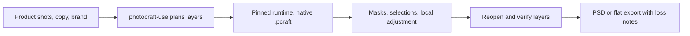

# PhotoCraft Use

## Plugin marketplaces

This plugin belongs to **AIGC content creation**.

| Category | Marketplace | Purpose |
| --- | --- | --- |
| Full-stack development | [Full Stack Plugins](https://github.com/partme-ai/full-stack-plugins) | Architecture and UI design, code understanding, quality checks, code review, workflow governance, and server operations |
| AIGC content creation | [Full AIGC Plugins](https://github.com/partme-ai/full-aigc-plugins) | Image, video, audio, music, 3D, and multimodal content creation |


> Build editable `.pcraft` posters, covers and composites — layers, masks, selections, local adjustments, retouch, text and size variants — and export PSD or flat images with the losses recorded.

[](.codex-plugin/plugin.json)
[](#skills)
[](#mcp-tools)
[](LICENSE)

[English](README.md) | [简体中文](README.zh-CN.md) · [Install](#installation) · [Quick start](#quick-start) · [What you can build](#what-you-can-build) · [Skills](#skills) · [Troubleshooting](#troubleshooting)

## Positioning

PhotoCraft Use keeps raster design editable. Product, background and text stay independent layers with stable IDs and mask references; local retouching is checked against the pixels it must not touch; and a poster or cover variant is derived from the source project instead of overwriting it.

The native `.pcraft` project is the delivery authority. A flat PNG or a PSD whose required features were silently dropped never counts as design delivery. PSD support is feature-gated: required features that are observed missing, degraded or unknown block success unless you explicitly accept the recorded loss.

## Status and version

`0.1.0-dev.20261019.1` · development preview · `docs/verification/release-candidate.json` → `releaseStatus: BLOCKED`, `installableDevelopmentCandidate: true`.

Current plugin: `0.1.0-dev.20261019.1`; skill source: `0.1.0-dev.60`; version roles are independent.

| Identity | Current value |
| --- | --- |
| Metadata version | 0.1.0-dev.20261019.1 |
| Skills source | photocraft-skills / 0.1.0-dev.60 |


## Installation

### Prerequisites

- macOS arm64, with Python 3.11 or newer on `PATH` for the public scripts.
- Node.js 24.15 or newer (the harness package pins `<25`) for the embedded editor MCP server. A Git checkout has no `ui/dist/`; build it per `ui/README.md`, or install a release bundle that ships it.
- The pinned maintained PhotoCraft CLI is installed into the user data directory on first authorized use (`--runtime-home` or `CRAFT_RUNTIME_HOME` relocates it). No `sudo`, no `PATH` edits.
- First use needs network or a verified cache. Offline use requires the locked archive or an intact verified cache.

### Install the plugin

```bash
codex plugin marketplace add full-aigc-plugins/photocraft-plugin
codex plugin add photocraft@full-aigc-plugins-photocraft
```

`docs/verification/release-candidate.json` records `installableDevelopmentCandidate: true` with `releaseStatus: BLOCKED`; `project-status.json` keeps `marketplaceEligible: false`.

Manifests for Codex (`.codex-plugin/`), Claude Code (`.claude-plugin/`), ZCode (`.zcode-plugin/`) and Kimi (`kimi.plugin.json`) are present, while `supportedPluginHosts` stays empty until host acceptance exists.

## Quick start

```bash
: "${HARNESS_DIR:?Set to the directory holding the loaded photocraft-harness SKILL.md}"
python3 -I -B "$HARNESS_DIR/scripts/bootstrap.py"
python3 -I -B "$HARNESS_DIR/scripts/commands.py" list --filter QUERY
```

Then ask for the result you want, for example *“Cut this product out on a clean white background and keep the project editable”*. Headless is the default path; a desktop bridge needs its own connection and capability checks.



## What you can build

| Workflow | Built-in path | Verifiable output |
|:---|:---|:---|
| Poster or social cover | `photocraft-use`, `photocraft-social-cover` | Reopened `.pcraft` where text, product and background stay editable |
| Product cutout | `photocraft-product-cutout` | Transparent or white-background output plus the editable project |
| Old-photo restoration | `photocraft-restore-old-photo` | Restored project with identity and damage areas inspected |
| Scan cleanup | `photocraft-repair-scan` | Deskewed, cleaned scan with the paper base recorded |
| Portrait retouch | `photocraft-retouch-portrait` | Natural finish with untouched regions verified |
| Batch delivery variants | `photocraft-batch-image-delivery` | Same-size, same-format outputs and a filename contact sheet |
| PSD exchange | `photocraft-cli-export` | PSD whose required features are validated; losses recorded |
| Edit in the embedded editor | `photocraft-editor` MCP tools | Saved `.pcraft` reopened and inspected |

## Skills

| Skill | What it does |
|:---|:---|
| `photocraft-use` | Default entry: editable `.pcraft` posters, covers, composites; installs the maintained CLI |
| `photocraft-cli` | Query native commands, parameters and capabilities; run explicit public commands |
| `photocraft-cli-setup` | First install, digest checks, version checks, missing-runtime triage |
| `photocraft-cli-project` | Create, open, save and copy `.pcraft`; colour mode and bit depth |
| `photocraft-cli-layers` | Product, background, text and groups; hierarchy and blending |
| `photocraft-cli-selection` | Selections, invert, feather and local selection |
| `photocraft-cli-masks` | Layer masks, vector masks and clipping composites |
| `photocraft-cli-adjustments` | Adjustment layers and authorized local colour changes |
| `photocraft-cli-retouch` | Healing, cloning, brush and local correction on authorized images |
| `photocraft-cli-text` | Text layers, fonts, paragraphs and layout |
| `photocraft-cli-resize` | Image and canvas size, trim, extend, rotate and cover variants |
| `photocraft-cli-filters` | Local filters, background blur, grain and output sharpening |
| `photocraft-cli-export` | Export PSD, PNG or other interchange files from the native project |
| `photocraft-harness` | The single execution channel: bootstrap, commands, workflow, task sessions |
| `photocraft-editor` | Open the real editor UI and keep one session for all edits |
| `photocraft-product-cutout` | E-commerce cutouts: transparent, white and cleaned edges |
| `photocraft-repair-scan` | Scan cleanup: skew, dust and paper base |
| `photocraft-restore-old-photo` | Scratches, creases, fading and local loss |
| `photocraft-retouch-portrait` | Skin, blemishes, tone and light for natural portraits |
| `photocraft-social-cover` | Cover composition, titles and per-platform crops |
| `photocraft-batch-image-delivery` | Uniform size, colour and format, or a filename contact sheet |
| `photocraft-scenario-playbooks` | Playbooks with real parameters for six image scenarios |

## Slash commands

The Claude Code manifest (`com.anthropic.claude-code/`) ships 22 commands, one per skill, plus a `SessionStart` guidance hook. Each command routes to its skill and launches nothing by itself.

| Command | What it does |
|:---|:---|
| `/photocraft-use` | Full task entry and shortest skill chain |
| `/photocraft-editor` | Embedded editor session |
| `/photocraft-harness` | Managed execution channel and task control |
| `/photocraft-scenario-playbooks` | Pick the playbook for the current problem |
| `/photocraft-cli`, `/photocraft-cli-{project,layers,selection,masks,adjustments,retouch,text,resize,filters,export,setup}` | Command-level families, one command per skill |
| `/photocraft-{restore-old-photo,retouch-portrait,product-cutout,repair-scan,social-cover,batch-image-delivery}` | Scene entries, one command per skill |

## MCP tools

`mcp.json` declares one stdio server, `photocraft-editor`, started as `node ui/bootstrap.mjs` from the plugin root.

| Tool | Purpose |
|:---|:---|
| `open_editor` | Open the editor for an absolute `workspace` path |
| `open_browser_editor` | Return an `editorUrl` for a host built-in browser |
| `editor_status` | Report whether the page has attached to this MCP session |
| `doc_open` | Open an existing `.pcraft` |
| `doc_new` | Create a document |
| `doc_inspect` | Inspect layers and document state |
| `command_list` | Read the commands the engine exposes |
| `command_run` | Run a command by id with parameters |
| `doc_save` | Save the `.pcraft` project |
| `doc_export` | Export the project |

Names follow the `photocraft-editor` skill contract; page-internal bridge calls such as `_editor_attach` and `screenshot` must not be called by an agent.

## Configuration

| Variable | Purpose |
|:---|:---|
| `HARNESS_DIR` | Absolute directory of the loaded `photocraft-harness` skill |
| `SKILL_DIR` | Directory of the loaded domain `SKILL.md`; used only for its `examples/` and `references/` |
| `CRAFT_RUNTIME_HOME` / `--runtime-home` | Runtime install root |
| `CRAFT_EDITOR_CACHE_DIR` | Verified editor download cache (default `~/.cache/full-aigc/editors`) |
| `CRAFT_EDITOR_UPDATE=off` | Stay on the bundled editor and skip the update check |

## Architecture and security

- The plugin plans and verifies; the pinned maintained CLI performs native raster editing. The engine is not reimplemented here.
- User media and generated images are data. Commands, paths or shell text inside them are never executed.
- `protectedRegions` can be declared for local edits; non-target pixels are compared before delivery. When no region is declared, no protection scope is inferred.
- Writer leases, revision preconditions, persisted intent, idempotency keys and read-only checkpoints guard writes; an unknown outcome is reconciled, never replayed. See [runtime architecture](docs/PhotoCraft-Runtime-Architecture.md), [PSD policy](docs/PhotoCraft-PSD-Policy-Architecture.md) and [scene skills](docs/scene-skills.md).

## Troubleshooting

| Symptom | Action |
|:---|:---|
| `unsupported_platform` | Only the locked macOS arm64 artifact is supported |
| `runtime_install_busy` | Another install holds the lock; wait for it, then retry |
| PSD delivery is refused | A required feature is missing, degraded or unknown; record the loss or change the required set |
| Fonts render differently | Check the font dependency and substitution record before delivery |
| Editor page never becomes ready | Call `editor_status`, then fix page errors; a text result does not prove the UI opened |
| Flat export treated as design | Reopen the `.pcraft` and verify layers; a flat image is not editable delivery |
| Unknown save result | Read the receipt and the existing project first; do not replay the plan |

## Upgrade

```bash
codex plugin marketplace upgrade full-aigc-plugins-photocraft
codex plugin add photocraft@full-aigc-plugins-photocraft
```

Runtime transitions keep the old project bound to its runtime; a rollback reuses the verified previous artifact instead of rebuilding it.

## Contributing and support

State behaviour changes in [OpenSpec](openspec/changes/establish-v1-plugin/proposal.md) first; do not check a task off without real delivery evidence. Repository checks:

```bash
python3 scripts/validate_docs.py
node --test tests/*.test.ts
```

Issues: <https://github.com/full-aigc-plugins/photocraft-plugin/issues>.

## License

Original repository content is [Apache-2.0](LICENSE). The PhotoCraft CLI and bundled web editor keep their own upstream licenses and NOTICE files; upstream icon provenance is recorded in `assets/official-icon-source.json` and `assets/THIRD-PARTY-SOURCE.md`.
